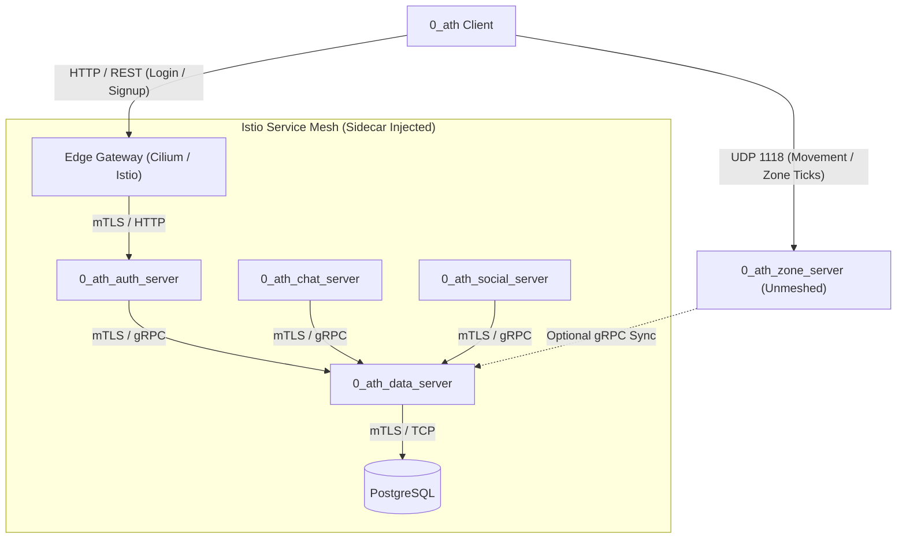

# Integrating Istio Service Mesh into 0ath

## 1. Overview & Feasibility

Can Istio be integrated into the `0ath` MMO infrastructure? **Yes, absolutely.**

`0ath`'s backend is already partitioned into discrete Go microservices communicating via **gRPC**, **HTTP/REST**, and **Postgres** (`0_ath_auth_server`, `0_ath_chat_server`, `0_ath_social_server`, `0_ath_data_server`, `0_ath_persistence_server`, and `0_ath_telemetry_server`). This architecture is an ideal target for learning and implementing a modern Service Mesh.

However, an MMORPG infrastructure has unique characteristics—specifically real-time UDP and QUIC traffic (`0_ath_zone_server` and `0_ath_movement_server`) alongside existing **Cilium eBPF** CNI and Gateway API implementations. Incorporating Istio requires a **hybrid architectural model** to avoid degrading game tick latency or destabilizing node resources.

---

## 2. Current 0ath Networking vs. Istio Capabilities

| Component | Current `0ath` Setup | With Istio Mesh Added |
|---|---|---|
| **CNI (L3/L4)** | **Cilium 1.15.5** (eBPF, `kubeProxyReplacement: true`) | **Cilium** remains underlying CNI for high-speed packet routing and eBPF |
| **Ingress (North-South)** | **Cilium Gateway API** (`gatewayClassName: cilium`, Envoy) | Can retain Cilium Gateway API at the edge, or adopt `istio-ingressgateway` |
| **Internal (East-West)** | Plain Kubernetes ClusterIP / Direct TCP & gRPC | **Istio mTLS**, Envoy sidecar proxies, traffic routing, circuit breakers |
| **Observability** | Netdata, Cilium Hubble, Custom eBPF agent, Perses | **Kiali** (topology graph), Envoy metrics, Jaeger distributed tracing |
| **Security** | Firewall scripts, network policies | **Strict mTLS** (`PeerAuthentication`), L7 gRPC RBAC (`AuthorizationPolicy`) |

---

## 3. The MMO Hybrid Architectural Model

The most critical architectural decision when introducing a service mesh to an online multiplayer game is **traffic categorization**:



### A. Meshed Services (L7 HTTP & gRPC)
- **Target Services**: `auth-service`, `chat-service`, `social-service`, `data-service`, `persistence-service`, `telemetry-server`.
- **Why**: These services perform business logic, transactional queries, player metadata lookups, and chat distribution. They benefit heavily from:
  - Transparent mutual TLS (mTLS) with cryptographic identity (`spiffe://`).
  - Automatic retries, timeouts, and circuit breakers.
  - Granular telemetry (request rate, error rate, P99 latency per gRPC method).
  - Dynamic canary routing and traffic splitting.

### B. Unmeshed Services (Low-Latency UDP / QUIC)
- **Target Services**: `0_ath_zone_server` (`zone-statefulset`, UDP port 1118) and `0_ath_movement_server` (QUIC).
- **Why**: Envoy sidecars intercept traffic via `iptables` or eBPF socket redirection. Injecting a user-space proxy into 30Hz–60Hz game loop packets introduces:
  - Extra context switching and memory copies.
  - Jitter and latency spikes detrimental to tick synchronization.
  - Potential packet drops on high-throughput UDP datagram streams.
- **Architectural Rule**: Keep `zone` and `movement` outside the sidecar injection perimeter using pod annotations (`sidecar.istio.io/inject: "false"`) or by placing them in a dedicated namespace (`game-runtime`).

---

## 4. Cilium CNI + Istio Coexistence

A common question is whether **Cilium** and **Istio** conflict. They do not—they operate at complementary layers:
- **Cilium** operates in the Linux kernel via eBPF (Layer 3/4 packet forwarding, pod routing, kube-proxy replacement, XDP).
- **Istio** operates primarily in user-space via Envoy sidecars (Layer 7 application protocols, mTLS handshakes, HTTP/gRPC inspection).

### Considerations for `0ath`:
1. **Sidecar Interception**:
   With `kubeProxyReplacement: true` and `bpf.tproxy: true` in `0ath`'s `k0s.yaml`, Cilium respects standard iptables redirection in the pod network namespace created by `istio-init`.
2. **Gateway Strategy**:
   - *Option A (Hybrid / Recommended)*: Retain the existing `public-gateway` (`gatewayClassName: cilium`) for public ingress (avoiding disruptions to Hetzner host ports). Cilium routes `/` to `auth-service`, which forwards into the Istio mesh.
   - *Option B (Pure Istio Ingress)*: Deploy `istio-ingressgateway` to handle all external traffic through Istio's native gateway controller.

---

## 5. Node Resource Budgeting (k0s on Hetzner)

Previous incidents (`cilium_gateway_api_deadlock.md`) demonstrated that constrained single-node environments can experience memory and compilation timeouts.

To safely run Istio:
- Use the **minimal** or tuned **default** profile.
- Limit `istiod` resources:
  ```yaml
  pilot:
    resources:
      requests:
        cpu: 100m
        memory: 256Mi
      limits:
        cpu: 500m
        memory: 512Mi
  ```
- Tune sidecar proxy overhead:
  ```yaml
  global:
    proxy:
      resources:
        requests:
          cpu: 10m
          memory: 40Mi
        limits:
          cpu: 200m
          memory: 128Mi
  ```

---

## 6. Implementation Plan

### Step 1: Install `istioctl` & Deploy Istio Control Plane
```bash
# Download and install Istio CLI
curl -L https://istio.io/downloadIstio | sh -
export PATH=$PATH:$PWD/istio-1.22.0/bin

# Install Istio with resource constraints
istioctl install --set profile=default \
  --set values.pilot.resources.requests.memory=256Mi \
  --set values.pilot.resources.limits.memory=512Mi -y
```

### Step 2: Namespace & Pod Configuration
Enable automatic injection on the default namespace, but explicitly exclude real-time game pods:
```bash
kubectl label namespace default istio-injection=enabled
```

In `0_ath_manifests/services/stateful-services.yaml` (`zone-statefulset`):
```yaml
spec:
  template:
    metadata:
      labels:
        app: zone
      annotations:
        sidecar.istio.io/inject: "false"
```

In `0_ath_manifests/services/internal-services.yaml` and `auth-service.yaml`:
Ensure deployment templates either omit the annotation (inheriting namespace `enabled`) or have `sidecar.istio.io/inject: "true"`.

### Step 3: Observability Addons (Kiali & Jaeger)
Deploy the visualizer addons into `istio-system`:
```bash
kubectl apply -f https://raw.githubusercontent.com/istio/istio/release-1.22/samples/addons/kiali.yaml
kubectl apply -f https://raw.githubusercontent.com/istio/istio/release-1.22/samples/addons/jaeger.yaml
```

---

## 7. Service Mesh Learning Curriculum on 0ath

Once running, `0ath` provides real-world scenarios to master Service Mesh concepts:

1. **Service Graph & Topology (Kiali)**:
   - Access Kiali via `kubectl port-forward -n istio-system svc/kiali 20001:20001`.
   - Fire authentication and chat requests from `0_ath_client` and observe traffic flows, error rates, and connection graphs in real-time.

2. **Strict Mutual TLS (`PeerAuthentication`)**:
   - Enforce cryptographic mTLS across all backend services:
     ```yaml
     apiVersion: security.istio.io/v1beta1
     kind: PeerAuthentication
     metadata:
       name: default
       namespace: default
     spec:
       mtls:
         mode: STRICT
     ```
   - Verify that plaintext curl requests between pods are rejected, while meshed gRPC requests continue uninterrupted.

3. **Canary Releases & Traffic Splitting (`VirtualService` & `DestinationRule`)**:
   - Deploy `chat-service:v1` and `chat-service:v2`.
   - Direct 90% of chat traffic to v1 and 10% to v2 to test new chat features without risking full downtime.

4. **Resilience & Chaos Testing**:
   - Inject 500ms delay into `data-service` calls to test client timeouts and circuit breaker triggers in `0_ath_chat_server`.

5. **L7 Authorization Policies (`AuthorizationPolicy`)**:
   - Restrict access to `data-service` so that only pods with the service identity of `chat`, `social`, or `auth` can execute queries.
